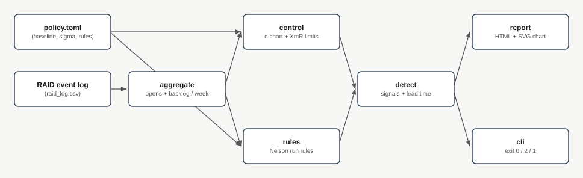
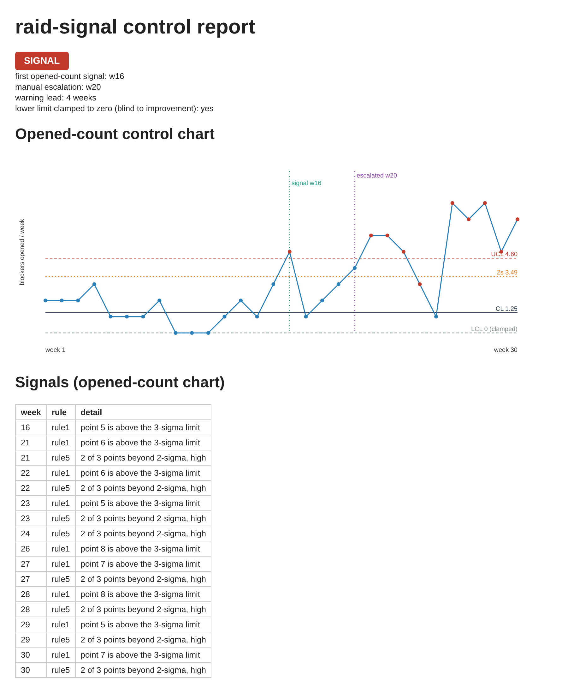
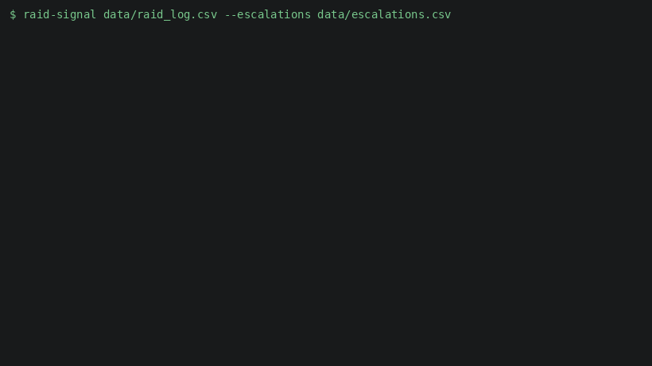

# raid-signal

**Puts statistical process control over a RAID log so a blocker spike trips a gate before a human escalates. On a seeded 30-week program it signalled in week 16, four weeks before the team escalated in week 20.**

[](https://github.com/Venkata-Pramid-Reddy-Mitta/raid-signal/actions/workflows/ci.yml)


A RAID log (Risks, Assumptions, Issues, Dependencies) is a list. A programme manager reads it every week and asks one question it cannot answer: is this week normal churn, or the start of trouble? A raw count of open blockers has no baseline, so the honest answer from the list alone is a judgement call, and the judgement usually arrives late.

## The questions a RAID list cannot answer

1. Is this week's blocker count inside the range this team normally produces, or outside it? A count has no range until you compute one.
2. If it is outside the range, how many weeks earlier than the manual escalation would that have been visible?
3. What does that early warning cost in false alarms on a quarter where nothing was actually wrong?
4. When the count instead *improves*, can the chart say so? (It cannot, and the README leads with why.)

raid-signal supplies the baseline the list structurally lacks: control limits frozen on the team's own stable history, plus Nelson run rules that read the sequence rather than the single point.

## The uncomfortable numbers, first

- **The lower control limit is clamped to zero in 100% of weeks.** For a low Poisson count the limit `centre - 3*sqrt(centre)` is negative, so it clamps to zero, so a week can never fall below it. The chart can tell you the RAID got worse; by construction it is far slower to tell you it got better. Halving the blocker rate for the whole back half of the programme produced zero signals.
- **The run rules bought nothing here.** On this spike the single 3-sigma breach fired 5 weeks before the earliest run rule, not the other way around. The run rules earn their place on slower drifts, not this one, and the repository says so instead of implying otherwise.
- **The warning is not free.** On a matched stable programme with no planted shift, the opened-count chart still raised 3 false-signal weeks, and the backlog chart fires on 6 of the 18 post-baseline weeks, which is exactly why the gate ignores the backlog chart.

Against those, the result that matters: the gate signalled **in week 16**, a lead of 4 weeks over the manual escalation **in week 20**.

Every number in this document is re-measured by `tools/collect_metrics.py` and guarded by `tools/check_numbers.py`, which fails the build if the prose drifts from the code. There are **104 tests** at **100% line coverage**.

## Quickstart

Prerequisites: Python `3.11`, `3.12` or `3.13`. No network, no credentials.

```bash
pip install -e ".[dev]"

# The headline number: signal week, and the lead over the manual escalation.
raid-signal data/raid_log.csv --escalations data/escalations.csv

# Everything, from a fresh clone, offline:
make verify
```

`make verify` runs the linter, the full test suite, re-measures every figure, and checks the prose against it.

## What it measures

### The warning lead over a manual escalation

The escalation log records the week a human actually escalated the blocker spike. The gate reaches the same conclusion earlier.

| quantity | value |
|---|---|
| manual escalation | week 20 |
| first opened-count signal | week 16 |
| warning lead | 4 weeks |

The lead is `escalation_week - first_signal_week`, measured against a recorded human decision rather than against anything the tool defines for itself, so it cannot be circular (`experiments/exp01_lead_time.py`).

### What the warning costs on a stable programme

The same rules run on a matched fixture with no planted shift. What fires there is the false-alarm cost.

| chart | false-alarm weeks | of post-baseline weeks |
|---|---|---|
| opened-count (the gate) | 3 | 18 |
| backlog (diagnostic only) | 6 | 18 |

The backlog chart fires on 6 of the 18 weeks because a backlog *level* carries last week's value forward (it is autocorrelated), which breaks the independence an individuals chart assumes. That is the whole reason the gate rests on the opened-count chart and treats the backlog chart as a diagnostic (ADR-004, `experiments/exp02_false_alarms.py`).

### Which rule fired first

The run rules exist to catch a drift the single out-of-limit point misses. The honest finding on this spike is the opposite of the sales pitch:

| rule | first firing (opened chart) |
|---|---|
| rule 1 (one point beyond 3-sigma) | week 16 |
| rule 5 (two of three beyond 2-sigma) | week 21 |

The 3-sigma breach led the run rules by 5 weeks. A gentler drift is where a run rule would lead instead; this spike was steep enough that the plain limit caught it first (`experiments/exp03_run_rules_vs_3sigma.py`).

### What it costs against what it buys

| | it buys | it costs |
|---|---|---|
| run rules on the opened chart | earlier warning on a slow drift | more false alarms per rule enabled |
| gating on opened, not backlog | 3 false-signal weeks, not 6 | blind to a backlog that climbs while opens stay flat |
| clamping the lower limit to zero | a defined, non-negative count chart | no signal can ever fire for an improvement |

## The bug the measurement found

Nelson rule 3 (six points in a row all increasing or all decreasing) was first written with `>=` and `<=`, so a week whose count equalled the week before counted as both an increase and a decrease. Experiment 3 then reported a trend firing across a plateau: on the real fixture, rule 3 fired on the opened chart in week 22 (counts `1,2,3,4,6,6`) and on the backlog chart in weeks 16 and 30, each window holding a repeated value. A trend rule has no business firing across a flat stretch, so all three were wrong.

Switching to strict `>` and `<` removed all three false trends and left every real signal untouched: the week-16 breach and the 4-week lead never depended on rule 3. The fix is one commit, and `tests/test_rule3_regression.py` pins each direction, the plateau cases, and the five-versus-six boundary so it cannot come back.

## Architecture



Source (rendered to the committed SVG by `tools/render_diagrams.py`, not by GitHub):

```diagram-source
log(raid_log.csv) -> aggregate
policy.toml -> control, rules
aggregate(opens + backlog per week) -> control(c-chart + XmR limits), rules(Nelson rules)
control, rules -> detect(signals + lead time)
detect -> report(HTML + SVG), cli(exit 0 / 2 / 1)
```

## Evidence



The control report above is generated by the tool from the committed data (`raid-signal ... --report`), and `tools/capture_screenshots.py` reads back the verdict badge's computed style and fails if it is ever invisible.



The replay types each command and reveals its captured output paced by the measured wall time (`tools/record_demo.py`). Every line of terminal text is real captured output, not typed, and `docs/video/manifest.json` records each command with its exit code and duration.

## The corpus

Two fixtures, both generated by one seeded generator (`tools/generate_data.py`) and committed, so every number reproduces offline:

- `data/raid_log.csv`: a real 30-week programme, 154 RAID items, 92 of them blockers. A stable first quarter, then a blocker rate that ramps into a spike and a recorded escalation in week 20.
- `data/raid_log_stable.csv`: a genuinely in-control programme with no planted shift, used only to measure false alarms.

The awkward cases are deliberate: the stable fixture is not quiet (its backlog wanders, which is what makes the backlog chart over-fire and justifies the gate's boundary), and the real fixture's drift begins quietly inside the limits so the single-point rule has to wait for a true breach.

## What this cannot measure

This is a boundary, not a footnote.

- **A backlog level is not independent.** An individuals chart assumes each point is a fresh draw; a backlog carries last week's value forward. The backlog chart is therefore a diagnostic, never the gate (ADR-004).
- **The Poisson count chart is blind to improvement.** The clamped lower limit means a drop in the count can never breach a limit. Detecting a sustained *improvement* needs a different chart (the Pivot, below).
- **The baseline is declared, not learned.** The limits are frozen on weeks 1 to 12 and assumed representative. A wrong baseline poisons every later judgement; the tool cannot tell you the baseline you gave it was itself abnormal (ADR-005).
- **A c-chart assumes a constant area of opportunity.** If the team size changes, the opening rate shifts for a reason the chart reads as a signal. The fixtures hold team size fixed; the real world does not (ADR-001).

## Layout, exit codes, reproduction

```
src/raid_signal/   aggregate, control (the SPC maths), rules (Nelson), detect, report, cli
config/policy.toml baseline window, sigma, which run rules are active
data/              committed seeded fixtures + the escalation log
experiments/       the four questions above, each writing JSON to docs/experiments/
tools/             generator, metrics collector, number checker, diagram + evidence
```

Exit codes distinguish the answer from a failure:

| code | meaning |
|---|---|
| 0 | ran, opened-count chart in control (no escalation needed) |
| 2 | ran, a signal fired (the answer is: escalate) |
| 1 | failed to answer (bad input, missing file, invalid policy) |

```bash
make verify   # lint, test, re-measure, check prose against code; offline
```

`tools/check_numbers.py` matches anchor phrases, not bare digits, so a stale sentence around a correct number is caught while a coincidental digit elsewhere is not.

## Tech stack

| technology | role here | why this one |
|---|---|---|
| numpy | the control-limit arithmetic | vectorised square-root and moving-range maths; the Excel formulas a PM already knows, made reproducible |
| pandas | event log to weekly series | the pivot-table step, written so the counts are reproducible rather than clicked |
| no SPC library | the chart maths is author-built | the limits are closed-form; building them keeps every number defensible line by line and deterministic |
| standard-library SVG | the control chart in the report | deterministic to the bytes, no plotting dependency at runtime |
| pytest + coverage | 104 tests, measured coverage | properties as test names; coverage enforced, not asserted |
| ruff | lint | one fast tool for import order, style and common bugs |

## Decisions (ADRs)

- [ADR-001](docs/adr/ADR-001-c-chart-for-opened-counts.md): a Poisson c-chart for opened counts, and the constant-area-of-opportunity boundary.
- [ADR-002](docs/adr/ADR-002-build-the-spc-maths.md): build the control-limit maths rather than take a library.
- [ADR-003](docs/adr/ADR-003-run-rules-and-their-cost.md): add Nelson run rules, and price the false alarms each one buys.
- [ADR-004](docs/adr/ADR-004-clamp-lower-limit-and-gate-on-opened.md): clamp the lower limit, declare the chart blind to improvement, gate on opened not backlog.
- [ADR-005](docs/adr/ADR-005-declared-baseline.md): freeze the limits on a declared baseline instead of re-learning them each week.

## The Pivot, and future work

Out of scope on purpose: an EWMA or CUSUM chart for a small sustained shift. The trigger for adding it is a concrete need to catch a drift smaller than about 1.5 sigma held over many weeks, which Shewhart limits and these run rules are weak at. Until that need is real, adding it would be a chart nobody asked to read.

- A u-chart that normalises by team size, so a change in the area of opportunity stops reading as a signal (closes the ADR-001 boundary). First metric to watch: false alarms on a fixture where team size steps up mid-programme.
- A second one-sided chart tuned for improvement, to answer the question the clamped lower limit cannot.
- A real Jira or Azure DevOps export adapter behind the same `RaidItem` boundary, so the offline fixture path and a live path share one analysis.
